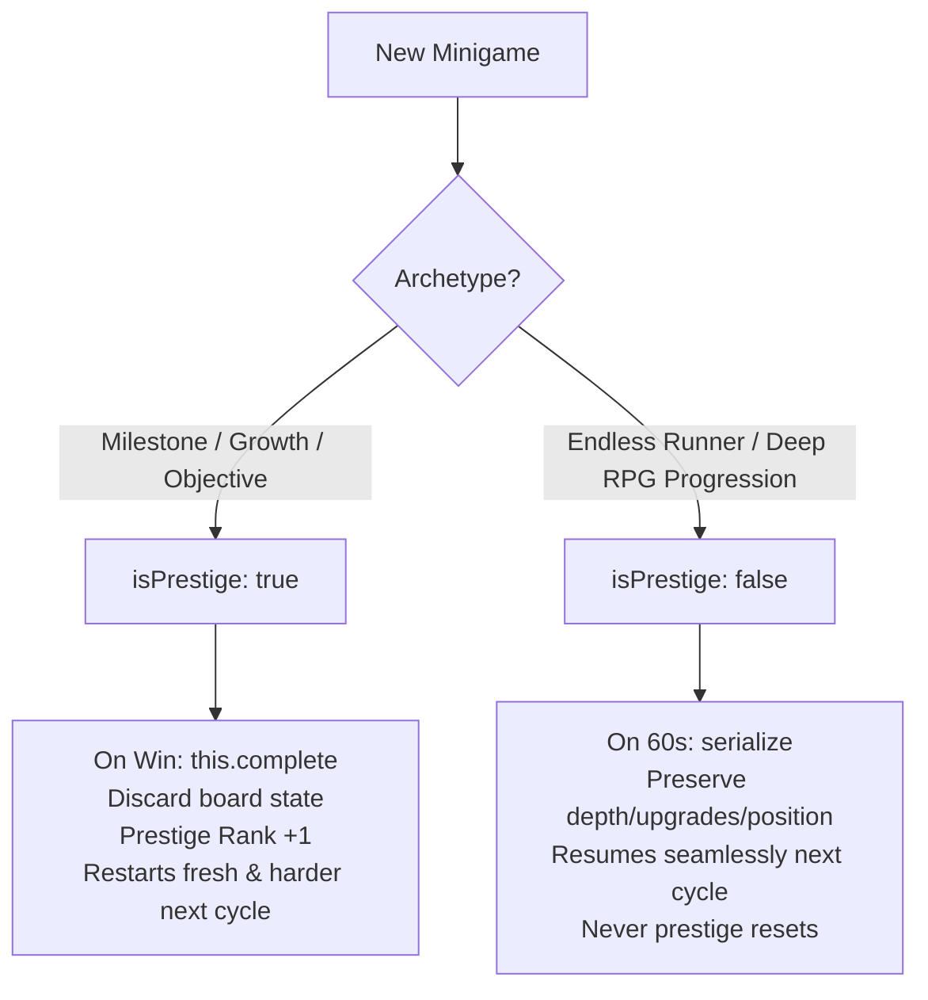

# 🕹️ Game Reels — Universal Minigame Playbook & Architecture Contract

This document is the **official standard** for creating, styling, and integrating minigames into **Game Reels**. Every minigame in the gauntlet must conform to this playbook so that all games share identical visual polish, safe-zone layouts, input ergonomics, and run-loop reset mechanics.

---

## 📑 Table of Contents
1. [Core Engine Contract](#1-core-engine-contract)
2. [The Two Game Archetypes](#2-the-two-game-archetypes)
3. [Visual & Layout Standards ("How It Looks")](#3-visual--layout-standards-how-it-looks)
4. [Prestige & Difficulty Scaling ("How It Resets")](#4-prestige--difficulty-scaling-how-it-resets)
5. [Input, Audio & FX Standards](#5-input-audio--fx-standards)
6. [Step-by-Step: Adding a New Game in 3 Minutes](#6-step-by-step-adding-a-new-game-in-3-minutes)
7. [Reference Template](#7-reference-template)

---

## 1. Core Engine Contract

Every minigame **must** extend the base class `Game` from `src/engine/Game.js`:

```javascript
import { Game } from '../engine/Game.js';

export class MyGame extends Game {
  static meta = {
    id: 'my-game',               // Unique slug (kebab-case)
    title: 'My Game Title',      // Display title in HUD & banners
    icon: '🎯',                  // Single emoji for top navigation pips & chips
    hint: 'DRAG to aim · TAP to fire · defeat the confectionery boss!',
    baseLikes: 3500,             // Starting social like count
    isPrestige: true,            // true = Milestone/Prestige, false = Continuous/Endless
    roundLen: 60,                // Round timer in seconds (standard: 60)
  };

  init(saved, score = 0) { ... }
  update(dt) { ... }
  render() { ... }
  serialize() { ... }
  restoreLabel() { ... }
  destroy() { ... }
}
```

### Standard Lifecycle Methods:
| Method | Trigger | Purpose |
| :--- | :--- | :--- |
| `init(saved, score)` | When the reel switches to this game | Initialize entities. If `saved` is present, restore saved state. `this.prestige` is already populated. |
| `update(dt)` | Every frame while `mode === 'playing'` | Physics, input polling, collision, win/loss checks. `dt` is in seconds (clamped to max `0.05s`). |
| `render()` | Every frame | Draw background, game objects, mascot bean, and particle FX onto `this.ctx`. |
| `serialize()` | At 60s timer expiration or manual jump | Return a JSON-safe object containing the minimal state to freeze. |
| `restoreLabel()` | When resuming a frozen game | Short string for the `"Welcome back — [restoreLabel]"` toast (e.g. `"depth 420m"` or `"tier 5"`). |
| `destroy()` | When the game is unloaded | Remove DOM listeners or clear physics engines (`Matter.Composite.clear()`). |

---

## 2. The Two Game Archetypes

Every game in Game Reels belongs to **one of two archetypes**. Declare this in `static meta.isPrestige`:



### Archetype A: Milestone / Prestige (`isPrestige: true`)
* **Examples**: `void-eater`, `deep-feeder`, `fruit-merge`, `paper-turf`, `multiplier-runner`, `age-of-beans`, `bean-td`, `tower-slice`.
* **Characteristics**:
  - Growth games that hit maximum entity size or clutter the board at max levels.
  - Objective-based games that feature a boss, wave cap, or fortress destruction.
* **When Completed**:
  - Call `this.complete('Reason! 👑')`.
  - Awards a **+3,000 to +5,000 PTS** completion bonus.
  - Discards the maxed-out board (no glitchy giant entities saved!).
  - Increments prestige rank: `this.prestige + 1`.
  - Next cycle: Starts **fresh at Prestige Level II+** with a gold **"★ PRESTIGE II · HARDER"** badge on the HUD, harder enemy speeds, tighter margins, and higher multipliers.

### Archetype B: Continuous / Endless (`isPrestige: false`)
* **Examples**: `motherload`, `crossy-road`, `subway-surfers`, `doodle-jump`, `sled-surfers`, `zombie-fortress`.
* **Characteristics**:
  - Mining / RPG progression where the player digs thousands of meters deep and accumulates permanent drill/fuel upgrades.
  - Pure arcade distance runners.
* **Cycle Behavior**:
  - **NEVER resets on cycle completion.**
  - At 60s, `serialize()` freezes the current depth, inventory, and vehicle position.
  - On the next cycle, the player picks up right where they left off with a brief `this.grace` invulnerability window.
  - Only resets when the player actually dies (which eliminates it for the run).

---

## 3. Visual & Layout Standards ("How It Looks")

All games render to a portrait canvas sized **450 × 800** (scaled with device pixel ratio up to 2.5×).

```
 ┌─────────────────────────────────────────────────────────┐ Y = 0
 │  [TOP HUD SAFE ZONE - RESERVED BY ENGINE]               │
 │  • Pips Carousel  • 60s Timer Bar  • Score Pill         │
 │  • Cycle Indicator                 • ★ Prestige Badge   │
 ├─────────────────────────────────────────────────────────┤ Y = 130 (Game.SAFE_TOP)
 │                                                         │
 │                                                         │
 │  🎮 ACTIVE PLAYABLE FIELD (Game.PLAY_HEIGHT = 565px)    │
 │  • Keep all player entities, hazards & controls here!   │
 │  • Use `this.isInSafeBounds(y)` helper                  │
 │                                                         │
 │                                                         │
 ├─────────────────────────────────────────────────────────┤ Y = 695 (Game.SAFE_BOTTOM)
 │  [BOTTOM DOCK SAFE ZONE - RESERVED BY ENGINE]           │
 │  • Game Icon & Title • Hint Subtitle • Likes & Mute     │
 └─────────────────────────────────────────────────────────┘ Y = 800
```

### Visual Style Rules:
1. **Background**:
   - Rich vertical gradients (e.g., `#160f29` → `#2a1745` → `#110b22`).
   - Avoid flat solid colors or plain browser defaults.
2. **Cartoon Outline Aesthetics**:
   - All game shapes, sprites, and blocks must feature **2.0px to 3.0px bold outlines** (`#000000` or deep shadow `#1a0f2b`) to match the Jelly World comic art style.
3. **Mascot Beans**:
   - Use the shared engine function `drawBean(ctx, x, y, size, options)` for characters:
     ```javascript
     import { drawBean } from '../engine/bean.js';

     drawBean(ctx, this.player.x, this.player.y, 28, {
       color: '#00b4d8',
       bellyColor: '#90e0ef',
       eyes: this.dead ? 'cross' : 'happy',
       hat: this.prestige > 1 ? 'crown' : null, // Crown the player on prestige cycles!
     });
     ```
4. **Typography**:
   - Rely on `Outfit, system-ui, sans-serif` for canvas text to match the UI HUD.

---

## 4. Prestige & Difficulty Scaling ("How It Resets")

The base class provides an automated scaling helper: `this.scaleStat(baseVal, pctPerRank)`.

$$\text{Scaled Value} = \text{baseVal} \times \left(1 + \text{pctPerRank} \times (\text{prestige} - 1)\right)$$

### Scaling Examples in `init()`:
```javascript
init(saved, score = 0) {
  this.fx = new FX();
  this.score = score;

  // Level 1: 150 spd | Level 2: 172 spd | Level 3: 195 spd
  this.enemySpeed = this.scaleStat(150, 0.15);

  // Level 1: 100 HP  | Level 2: 125 HP  | Level 3: 150 HP
  this.bossHp = Math.round(this.scaleStat(100, 0.25));

  // Tighter tolerance on higher prestige
  this.tolerance = Math.max(3, 8 - 1.5 * (this.prestige - 1));
}
```

### Completion vs. Death:
* **Triggering Win**:
  ```javascript
  this.complete('Singularity Reached! 🌌');
  ```
  *(Engine automatically handles gold flash, victory chime, haptics, score bonus, prestige promotion, and safe transition).*
* **Triggering Loss**:
  ```javascript
  this.die('Crushed by boulder! 💀');
  ```
  *(Engine automatically marks game eliminated for the run, plays fail sound, and shakes screen).*

---

## 5. Input, Audio & FX Standards

Use the pre-injected environment tools (`this.input`, `this.sounds`, `this.haptics`, `this.fx`).

### 1. Input (`this.input`):
* **Virtual Joystick / Touch Drag**:
  ```javascript
  const v = this.input.vec(50); // Normalized vector { x, y } clamped to 50px radius
  this.player.x += v.x * speed * dt;
  ```
* **Tap / Press**:
  ```javascript
  if (this.input.pressed) {
    const { x, y } = this.input.pos; // Coordinates on 450x800 canvas
  }
  ```
* **Keyboard**:
  ```javascript
  if (this.input.key(' ', 'arrowup', 'w')) { ... }
  ```

### 2. Audio & Haptics:
* **Feedback Triggers**:
  - Normal action: `this.sounds.pop()`, `this.haptics.light()`
  - Positive pickup: `this.sounds.up()`, `this.haptics.medium()`
  - Impact / Danger: `this.sounds.hit()`, `this.haptics.heavy()`
  - Stage Clear: `this.sounds.survive()`, `this.haptics.success()`
  - Elimination: `this.sounds.fail()`, `this.haptics.fail()`

### 3. Particle FX (`this.fx`):
```javascript
// Floating score indicator
this.fx.text(x, y - 20, '+250 PTS', '#ffd166', 22, 0.8);

// Confetti / particle burst
this.fx.burst(x, y, '#ff70a6', 15, 180, 0.6, 4);

// Shockwave ripple
this.fx.ring(x, y, '#3dffa2', 120, 0.5, 5);

// Screen shake
this.fx.shake(10, 0.3); // intensity, duration
```

---

## 6. Step-by-Step: Adding a New Game in 3 Minutes

1. **Copy the Template**:
   Copy [`src/games/_template.js`](file:///C:/Users/Eggwi/.gemini/antigravity-ide/scratch/game-reels/src/games/_template.js) to `src/games/myGame.js`.
2. **Define Metadata**:
   Set `id`, `title`, `icon`, `hint`, and decide `isPrestige: true` or `false`.
3. **Implement Logic**:
   Write your movement inside `update(dt)`, render in `render()`, and call `this.complete()` or `this.die()`.
4. **Register in `src/engine/Reel.js`**:
   Add 2 lines to [`src/engine/Reel.js`](file:///C:/Users/Eggwi/.gemini/antigravity-ide/scratch/game-reels/src/engine/Reel.js):
   ```javascript
   import { MyGame } from '../games/myGame.js';

   // Add to GAMES array:
   const GAMES = [..., MyGame];
   ```
5. **Instant Test**:
   Open browser at: `http://localhost:5173/?game=my-game`. The engine auto-launches your game immediately!

---

## 7. Reference Template

The full annotated template is located in:
👉 **[`src/games/_template.js`](file:///C:/Users/Eggwi/.gemini/antigravity-ide/scratch/game-reels/src/games/_template.js)**
